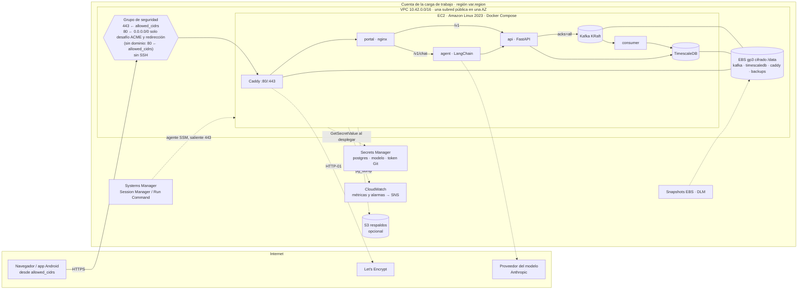
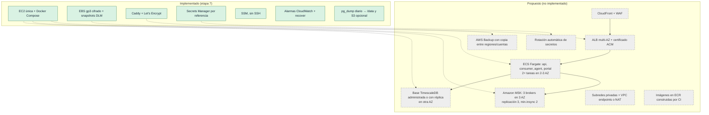
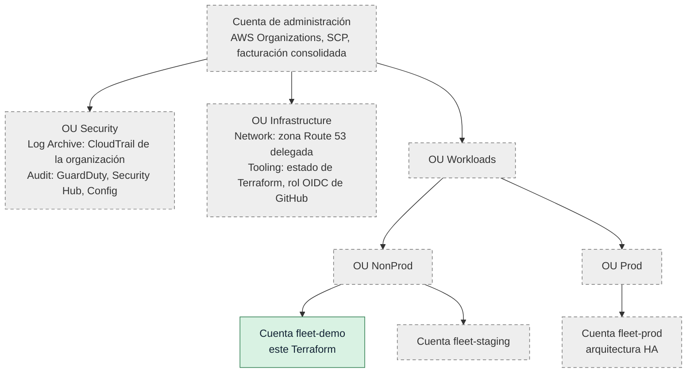

# Despliegue del MVP en AWS: arquitectura, decisiones y límites

Etapa 7. El entregable es **código validado y documentación**; los recursos aún no se crearon en ninguna cuenta. Todo lo que dice "verificado" en este documento se refiere a validación sintáctica y estática sin credenciales (ver [infra/README.md](../infra/README.md#niveles-de-verificación)).

## Arquitectura implementada

Una instancia EC2 con Docker Compose ejecuta el mismo stack que en local (Kafka, TimescaleDB, API, consumidor, agente y portal), más Caddy como proxy de entrada. El override [`infra/deploy/compose.aws.yml`](../infra/deploy/compose.aws.yml) reutiliza `docker-compose.yml` sin copiarlo.

**Flujo de despliegue:** `terraform apply` crea la red, la instancia, el volumen y los permisos. En el primer arranque, `user_data` instala Docker, Compose y Buildx (versiones fijas, checksum verificado) y ejecuta `fleet-deploy <SHA>`, que obtiene ese commit exacto y corre `infra/deploy/deploy.sh`. Las actualizaciones posteriores se lanzan por SSM Run Command con otro SHA.

### Por qué sirve para una demo

- **Mismo artefacto que en local:** el Compose que pasó las pruebas de carga y caos es el que corre en AWS. El override solo cierra puertos, cambia credenciales y mueve los datos a `/data`. No hay una segunda definición que mantener.
- **Pocos recursos y fáciles de explicar:** una VPC, una instancia, un volumen, un grupo de seguridad y un rol. `terraform destroy` lo quita todo, salvo lo que se retiene a propósito (snapshot final y bucket con respaldos).
- **Costo acotado y predecible:** no hay balanceador, NAT Gateway, MSK ni base administrada (ver [Recursos con costo](#recursos-con-costo)).
- **Sin puertos de administración:** sin SSH ni pares de claves; el acceso es por Session Manager, con permisos IAM y registro en CloudTrail.
- **Datos que sobreviven a la instancia:** Kafka y TimescaleDB viven en un volumen EBS separado que se vuelve a montar si la instancia se reemplaza.

### Puntos únicos de falla

| Componente | Si falla | Mitigación actual | Qué falta |
|---|---|---|---|
| Instancia EC2 (host físico) | Todo el servicio cae | Alarma `StatusCheckFailed_System` con acción `recover` (misma instancia, IP y volúmenes) | Varias instancias en varias AZ |
| Zona de disponibilidad | Todo el servicio cae; el volumen EBS no se puede usar en otra AZ | Snapshots DLM, restaurables en otra AZ a mano | Diseño multi-AZ |
| Volumen EBS `/data` | Pérdida de Kafka y TimescaleDB | Snapshots periódicos, `pg_dump` diario y copia opcional a S3 | Réplicas de Kafka y de la base |
| Broker Kafka único (factor de replicación 1) | La API responde `503`/`retryable`; los clientes reenvían | `acks=all`, idempotencia, reemplazo del productor (etapa 6) y deduplicación por `event_id` | 3 brokers en 3 AZ (MSK) |
| TimescaleDB única | El consumidor se detiene y el lag crece; la ingesta sigue en Kafka | Kafka retiene y el consumidor retoma (escenario B de caos) | Réplica en espera o servicio administrado |
| Caddy / portal | Sin acceso de usuarios | Reinicio automático (`unless-stopped`) | Balanceador con varias instancias |
| Certificado | Sin HTTPS si Let's Encrypt no valida | Renovación automática; el certificado persiste en `/data/caddy` | ACM detrás de un ALB o de CloudFront |
| Proveedor del modelo | Solo falla el chat | Circuit breaker y fallos acotados del agente | — |
| Secrets Manager | Solo falla un despliegue nuevo; lo que corre usa `/etc/fleet/secrets.env` | — | — |

### Evolución a alta disponibilidad

Las piezas **verdes** están implementadas en esta etapa; las **grises con borde punteado** son una propuesta sin implementar.

Orden sugerido, de mayor a menor efecto sobre la disponibilidad:

1. **Imágenes en ECR construidas por CI**, firmadas con el SHA. Separa compilar de desplegar y es requisito para el resto.
2. **Kafka administrado (MSK)** con tres brokers. El código ya usa `acks=all` e idempotencia; solo cambian `KAFKA_BOOTSTRAP_SERVERS`, el factor de replicación de los tópicos y la autenticación (IAM o SASL/SCRAM).
3. **Base de datos fuera de la instancia.** RDS para PostgreSQL no ofrecía la extensión TimescaleDB según la última información disponible al escribir esto (verificarlo al decidir). Las alternativas son el servicio administrado de Timescale o PostgreSQL autogestionado con réplica en espera en otra AZ.
4. **API, consumidor, agente y portal en ECS** detrás de un ALB, con varias tareas. La API ya sirve SSE desde varias réplicas (cada una con su hub); el consumidor escala hasta el número de particiones (3).
5. **Subredes privadas** con VPC endpoints (SSM, Secrets Manager, CloudWatch, ECR, S3) o NAT, y WAF en el borde.

### Encaje en una organización de AWS con cuentas separadas

- **Este Terraform va en una cuenta de carga de trabajo no productiva** (por ejemplo `fleet-demo`). No crea recursos de organización ni de red compartida, y no asume nada de otras cuentas.
- **Estado de Terraform:** en un bucket S3 de la cuenta de herramientas, con versionado y bloqueo nativo (`backend.tf.example`). El despliegue lo hace un rol de la cuenta de demo que asume CI por OIDC o una persona por IAM Identity Center; no se usan claves de larga duración.
- **DNS:** la zona principal vive en la cuenta de red, que delega un subdominio (por ejemplo `demo.flota.example.com`) o registra el `A` hacia la Elastic IP de salida.
- **Secretos:** se crean en la cuenta de demo. Con una clave KMS propia, su política la administra la cuenta de seguridad o la propia cuenta, según la convención de la organización.
- **Guardas de la organización que conviene tener:** SCP de regiones permitidas, prohibición de desactivar CloudTrail y GuardDuty, y de crear usuarios IAM con claves de acceso. Nada de esta etapa las necesita desactivar.
- **Producción** se haría en otra cuenta con la arquitectura HA, no ampliando esta instancia.

## Decisiones

| Decisión | Motivo | Alternativa descartada |
|---|---|---|
| EC2 única con Compose | Reutiliza el stack probado en las etapas 1 a 6, con costo y complejidad mínimos | ECS/MSK desde el inicio: mucho más costo y trabajo para una demo |
| Amazon Linux 2023 desde el parámetro público de SSM | La AMI más reciente para la arquitectura del tipo de instancia (`x86_64` o `arm64`), sin IDs fijos por región | AMI fija: se desactualiza y depende de la región |
| Compose y Buildx desde GitHub con checksum | AL2023 trae Docker pero no el plugin Compose; versión fija y verificada | `curl \| sh` sin verificar |
| Volumen de datos separado, adjuntado por ID | Sobrevive al reemplazo de la instancia; el script lo localiza por `/dev/disk/by-id/...<vol-id>`, no por el nombre del dispositivo | Datos en el disco raíz: se pierden al reemplazar |
| Docker no arranca sin `/data` montado | Evita que Kafka o PostgreSQL creen datos vacíos en el disco raíz si falta el volumen | — |
| Caddy como proxy de entrada | HTTPS automático con Let's Encrypt, sin balanceador ni ACM | ALB + ACM: costo fijo y más piezas |
| Puerto 80 abierto al mundo solo con dominio | Let's Encrypt valida desde direcciones no publicadas; Caddy solo responde el desafío y redirige. El portal se sirve únicamente por 443, limitado a `allowed_cidrs` | Desafío DNS-01: requiere permisos sobre Route 53 |
| Secretos por ARN, leídos al desplegar | Terraform, `user_data`, salidas y estado no contienen valores; el archivo `/etc/fleet/secrets.env` es `0600` | Variables sensibles de Terraform: el valor queda en el estado |
| Contraseña de PostgreSQL URL-safe | Va dentro de `DATABASE_URL` sin escapar | Escapar en Compose: frágil |
| Contraseña sincronizada en cada despliegue | `ALTER ROLE` con el valor del secreto por stdin: rotar es actualizar el secreto y redesplegar | Rotación manual dentro del contenedor |
| SSM en lugar de SSH | Sin puertos de entrada, con acceso por IAM y auditado | Bastión o SSH restringido |
| Despliegue por SHA exacto | Inmutable y repetible; volver atrás es desplegar el SHA anterior | Rama: cambia sin aviso |
| `user_data` e `ami` ignorados tras crear la instancia | Cambiar la revisión o publicarse una AMI nueva no reemplaza la instancia (ni corta el servicio) | Reemplazo en cada cambio |
| Métricas propias con `put-metric-data` | Cuatro métricas, sin instalar el agente de CloudWatch | Agente de CloudWatch: más configuración |
| `t3.large` por defecto | Ver [Dimensionamiento](#dimensionamiento) | — |

## Persistencia y recuperación

### Qué sobrevive

| Evento | Kafka y TimescaleDB (`/data`) | Imágenes y contenedores | Configuración y secretos | Certificado | Comportamiento |
|---|---|---|---|---|---|
| Reinicio de un contenedor | Sí | Sí | Sí | Sí | Compose lo reinicia (`unless-stopped`) |
| Reemplazo de contenedores (`fleet-deploy`, `up -d`) | Sí (volúmenes con bind a `/data`) | Se recrean | Se regeneran desde Secrets Manager | Sí | Sin reinicializar datos |
| Reinicio de la instancia | Sí | Sí (disco raíz) | Sí | Sí | `fstab` monta `/data` (por UUID, `nofail`); Docker espera ese montaje y levanta los contenedores. `kafka-init` y `migrate` no se repiten porque no hace falta |
| Recuperación automática (`recover`) | Sí | Sí | Sí | Sí | Igual que un reinicio, en otro host |
| Detener y arrancar la instancia | Sí | Sí | Sí | Sí | Igual que un reinicio. Con `create_eip = false`, la IP pública cambia |
| Reemplazo de la instancia (`terraform apply -replace`, cambio de tipo, AMI) | **Sí**: el volumen se desacopla con la instancia detenida y se vuelve a adjuntar | No: se reconstruyen | Se regeneran | Sí (`/data/caddy`) | `user_data` reinstala y despliega `git_revision`; el script detecta el sistema de archivos existente y **no formatea** |
| Pérdida del volumen o de la AZ | Solo hasta el último snapshot o respaldo | — | — | Se emite otro | Restauración manual (ver [infra/README.md](../infra/README.md#restaurar-desde-un-snapshot)) |
| `terraform destroy` | Ver [Retención al destruir](#retención-al-destruir) | Se eliminan | Los secretos no los crea Terraform y quedan | Se elimina | — |

**Mensajes reconocidos y aún no escritos en disco:** con un solo broker y `acks=all`, Kafka confirma cuando el mensaje está en el log del broker, que puede estar todavía en la caché de páginas del sistema operativo. Un reinicio de contenedor no lo afecta (la caché es del host); **una caída abrupta del host puede perder los últimos mensajes confirmados**. Con varios brokers la confirmación exige réplicas en otras máquinas.

### Retención al destruir

- **Volumen de datos:** con `data_volume_final_snapshot = true` (por defecto), AWS crea un snapshot final antes de borrarlo y ese snapshot queda en la cuenta.
- **Snapshots de DLM:** al borrar la política no se borran los snapshots que ya creó; quedan hasta borrarlos a mano.
- **Bucket de respaldos:** `force_destroy = false`. Si tiene objetos, `terraform destroy` falla en ese recurso y los respaldos quedan; para borrarlo hay que vaciarlo antes de forma explícita.
- **Secretos:** no los crea Terraform; quedan.
- **Disco raíz:** se borra con la instancia (solo tiene imágenes, registros y `/etc/fleet`).

### Respaldos

| Mecanismo | Qué cubre | Frecuencia por defecto | Consistencia |
|---|---|---|---|
| Snapshots EBS (DLM) | Todo `/data`: Kafka, TimescaleDB, certificados y respaldos locales | Cada 24 h a las 03:00 UTC, se retienen 7 (`snapshot_interval_hours`, `snapshot_retain_count`) | **Consistente ante caídas**: equivale a cortar la energía. Como Kafka y TimescaleDB están en el mismo volumen, el snapshot captura a ambos en el mismo instante. PostgreSQL se recupera con su WAL; Kafka recupera sus segmentos al arrancar |
| `pg_dump -Fc` (`fleet-backup`) | Solo la base `fleet` | Diario 02:30 UTC; local 30 días y copia opcional a S3 con caducidad (`backup_retention_days`) | Consistente para la base (una transacción). **No coordinado con Kafka** |

**Límite de consistencia entre la base y Kafka:** un `pg_dump` restaurado no contiene lo que se ingirió después, pero los offsets del consumidor siguen adelante. `fleet-restore --replay` mueve el offset del grupo `fleet-ingestion` al instante del respaldo para reingresar desde Kafka; es seguro porque el consumidor deduplica por `event_id`. Solo alcanza lo que siga dentro de la retención de Kafka (la predeterminada del broker, 7 días, porque el Compose no la cambia). Lo anterior a esa ventana se pierde.

### RPO y RTO

Son **objetivos propuestos, pendientes de validación**: ninguno se midió en AWS.

| Escenario | RPO objetivo | RTO objetivo | Cómo se validaría |
|---|---|---|---|
| Reinicio de un contenedor o de la instancia | 0 eventos confirmados | 5 min | Reiniciar con carga de k6 y reconciliar |
| Falla del host con `recover` | Segundos (mensajes en caché sin escribir) | 15 min | No se puede provocar a voluntad; se observa con la alarma |
| Reemplazo de la instancia | 0 (volumen intacto) | 30 min (reinstalar y reconstruir imágenes) | `terraform apply -replace=aws_instance.app` con datos y reconciliar |
| Pérdida del volumen o de la AZ | El intervalo de snapshot (24 h por defecto) | 2 h, manual | Restaurar un snapshot en otra AZ y reconciliar |
| Corrupción lógica de la base | Desde el último `pg_dump`, más la repetición desde Kafka dentro de su retención | 1 h | `fleet-restore --replay` sobre una copia |

## Dimensionamiento

No hay mediciones en AWS. Lo que sigue son **mediciones locales** de la etapa 6 (Docker en Windows, 4 CPU y 3,78 GiB para Docker; reportes en `loadtest/reports/2026-11-07/`):

- **Endpoint individual:** con 300 vehículos a 50 solicitudes/s durante 120 s se alcanzaron 48,7/s, con p95 de 1,76 s. Entre t+40 s y t+55 s Kafka dejó de responder a ~280 % de CPU y hubo 75 respuestas ambiguas.
- **Lotes:** 3.000 eventos en 120 lotes de 25 (2 lotes/s) con p95 de 82 ms por lote y todos los umbrales cumplidos.
- **Memoria:** los dos stacks (principal y de caos) no cupieron a la vez en 3,78 GiB. Con 384 MB de heap Kafka no arrancó; con 1 GB sí.
- **Persistencia y portal:** del 202 a la base p50 0,85 s y p95 1,76 s bajo carga; del 202 al SSE del portal p50 1,04 s y p95 1,56 s.

De ahí sale la configuración por defecto:

- **`t3.large` (2 vCPU, 8 GiB, x86_64):** duplica la memoria que necesitó el stack en local, deja holgura para compilar las imágenes en la propia instancia y fija el heap de Kafka en 512 MB a 1 GB. `timescaledb-tune` se limita a 2 GB para no competir con Kafka.
- **Pero tiene la mitad de vCPU que el entorno local**, y las `t3` funcionan con créditos de CPU. El cuello de botella observado fue la CPU de Kafka con el endpoint individual, así que **no se espera sostener 50 solicitudes/s individuales**. Para la demo (decenas de vehículos, o la app enviando por lotes) debería alcanzar. Para repetir la carga de la etapa 6 conviene un tipo sin créditos y con 4 vCPU (por ejemplo `m7i.xlarge`, o `m7g.xlarge` en Graviton), y medir de nuevo.
- **`data_volume_size_gb = 50`:** Kafka con la retención predeterminada de 7 días y los respaldos locales de 30 días. La alarma de disco avisa al 80 %.

**Pendiente:** repetir `load-300` y `batch-100` contra la instancia y ajustar el tipo con datos reales.

## Recursos con costo

No se incluyen precios: dependen de la región y cambian. Para estimar, use la calculadora de precios de AWS con estos recursos.

| Recurso | Se cobra por | Notas |
|---|---|---|
| Instancia EC2 | Horas en ejecución | Detenida no se cobra la instancia, pero sí sus discos y la IPv4 |
| EBS raíz y de datos (gp3) | GB-mes aprovisionados; IOPS y rendimiento por encima del nivel base | `data_volume_iops = 3000` es el nivel base de gp3 |
| Snapshots EBS | GB-mes de datos incrementales almacenados | Incluye el snapshot final y los de DLM que quedan tras destruir |
| Elastic IP / IPv4 pública | Horas por cada dirección IPv4 pública | AWS cobra las IPv4 públicas aunque estén asociadas |
| Transferencia de datos | GB salientes a Internet | Portal, SSE y descargas de imágenes y paquetes (entrantes) |
| CloudWatch | Métricas personalizadas (4), alarmas (7) y llamadas a la API | `fleet-health` publica cada minuto |
| Secrets Manager | Secretos por mes y llamadas a la API | 2 o 3 secretos; se leen solo al desplegar |
| SNS | Notificaciones | Solo con `alarm_email` |
| S3 | GB-mes, solicitudes y versiones anteriores | Solo con `backup_bucket_enabled` |
| KMS | Claves propias por mes y solicitudes | Solo si se indica una clave propia |
| Route 53 | Zona alojada y consultas | Si el dominio se administra en AWS |
| Proveedor del modelo | Tokens consumidos por el chat | Se factura fuera de AWS |

No se cobran recursos que esta configuración evita: NAT Gateway, balanceador, MSK, base administrada y endpoints de VPC.

## Limitaciones

- Una sola instancia en una sola AZ (ver [Puntos únicos de falla](#puntos-únicos-de-falla)).
- Las imágenes se compilan en la instancia; con la misma revisión, las dependencias resueltas por `pip` o `npm` sin versión exacta pueden variar entre compilaciones.
- Las contraseñas pasan a variables de entorno de los contenedores: las ve quien tenga acceso a Docker en la instancia (root por SSM).
- Kafka sin autenticación ni TLS dentro de la red de Docker de la instancia.
- `fleet-health` publica métricas, pero los registros de los contenedores se quedan en la instancia (rotación `json-file`, 5 × 10 MB por contenedor); no se envían a CloudWatch Logs.
- El primer despliegue con dominio puede terminar con aviso de HTTPS pendiente si el registro DNS aún no apunta a la IP.
- Sin VPC Flow Logs (trivy lo informa como MEDIUM). Se pueden agregar enviándolos a CloudWatch Logs o S3, con su costo.
- Docker viene del paquete de Amazon Linux 2023 (25.0.14 al validar) y Compose v5.6.1 se instala aparte. Su funcionamiento conjunto con el demonio en marcha no se probó; `compose_version` permite fijar otra versión.
- `terraform validate` no pudo completarse en el equipo de desarrollo por limitaciones del entorno (ver infra/README.md). Queda pendiente en CI.
- No se validó nada contra una cuenta real: ni el plan, ni el despliegue, ni las pruebas de recuperación.
